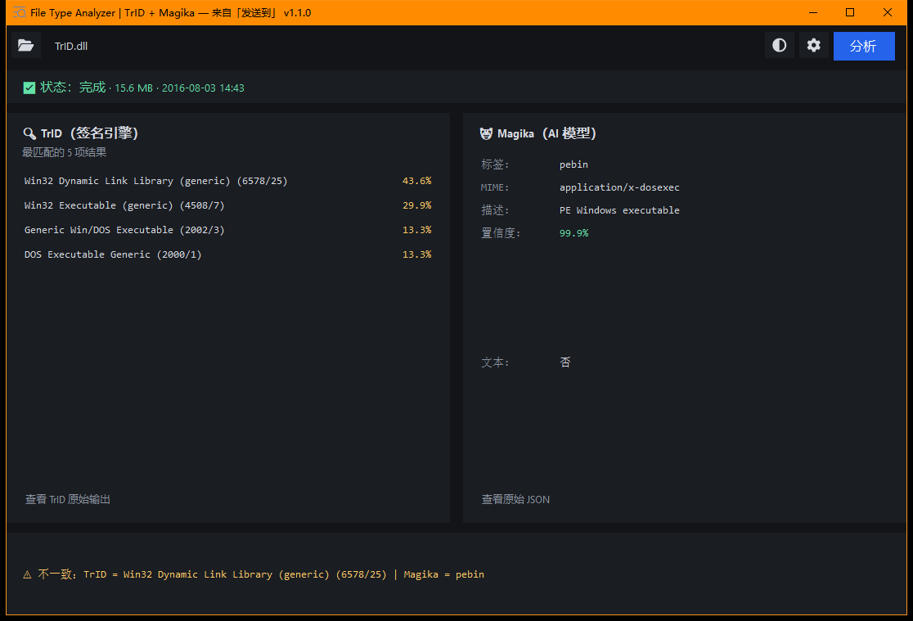

# File Type Analyzer

Windows 桌面小工具：用一个界面同时跑两套文件类型识别引擎，结果并排对比。



- **TrID** —— 基于文件签名的识别，使用托管引擎 `TrID.dll`（NuGet 包 TriDEngine 1.2.4），给出最匹配的 5 项文件类型和置信度。纯 .NET 实现，无 32 位原生依赖，进程保持 AnyCPU。签名定义可选用官方最新 XML 库（约 2.27 万条），未安装时回退到程序集内置的 2016 年快照（约 6300 条）。
- **Magika** —— Google Magika 的 CLI（AI 模型），给出标签、MIME、描述和置信分数。

两个引擎的结果会做一致性评估，用来判断"签名与模型是否给出同一结论"。

## 下载

[**FileTypeAnalyzer v1.2.0**](https://github.com/xkonglong/FileTypeAnalyzer/releases/latest) —— 解压即用，压缩包里已带 TrID 官方定义库（22,760 条）和 Magika CLI，不需要额外安装引擎。

运行需要 .NET 8 桌面运行时（Windows 10 及以上）。

## 界面

- 拖拽文件或点"打开"选文件，选完自动分析；
- 工具栏只有三个图标：打开、明暗主题切换、设置（语言 / 引擎更新）；
- 深色 / 浅色两套主题一键切换，图标为 Font Awesome 字形，随程序打包，不依赖系统字体；
- 中英双语，语言包放在 `lang/` 下的 JSON 里，可自行增改。

## 引擎更新

- Magika：调用 `magika -V` 读本地版本，与 GitHub `cli/v*` 最新 tag 比对；下载 Windows zip 后同目录暂存、实跑 `-V` 校验版本、备份 `.bak`、原子替换，失败回滚。
- TrID 定义库：从官方 `https://mark0.net/download/triddefs_xml.7z`（约 2.7 MB、2.27 万个 `*.trid.xml`）下载，用 SharpCompress 解压后装入引擎的 `PatternEngine.LoadDefinitionByXml`，替换本地定义目录。界面在设置里显示当前条数与包日期。
  更新前先做**日期比对**：对同一个 URL 发 `HEAD` 请求，比对远端 `Last-Modified` 与本地已装包的时间戳（精确到秒；老清单只有日期时按天比），远端不比本地新就不下载，只提示"已是最新"。检测失败（断网等）时仍允许手动下载。

定义库与缓存默认存放在**程序目录**（exe 同级，便携、跟着程序走）：

```text
<程序目录>\
├── defs\            官方 XML 定义（按 0…27 分目录，不带多余的 defs 外层）
├── triddefs.cache   解析后的二进制缓存（约 8 MB，首次装入后生成）
└── triddefs.json    清单：条数、包日期、包时间戳、包大小
```

程序目录不可写时（例如装进 `Program Files`），自动退回 `%LOCALAPPDATA%\FileTypeAnalyzer`。

首次装入 2.2 万个 XML 需要约 3.5 秒（后台线程执行，不挡窗体）；之后启动直接读缓存，加载只要一百多毫秒。删掉 `triddefs.cache` 会重新解析，删掉 `defs\` 和清单即回到内置定义。

## 构建

需要 .NET 8 SDK。构建命令：

```bat
dotnet build FileTypeAnalyzer.csproj
```

或直接双击 `编译.bat`（支持 `编译.bat release`）。

### 运行依赖

TrID 引擎改为托管实现后，只需要 `magika.exe`（可选，缺省时 Magika 面板显示未安装）：

| 文件 | 说明 |
| --- | --- |
| `TrID.dll` | 托管 TrID 引擎，程序集引用，构建时自动复制到输出目录 |
| `SharpCompress.dll` | 纯托管压缩库，用于解压官方 `.7z` 定义包（NuGet 依赖，随构建输出） |
| `magika.exe` | Magika CLI，可在设置里检查并下载更新 |

不再需要 `TrIDLib.dll`（32 位原生 DLL）和 `triddefs.trd`。

## 许可与致谢

- TrID：© Marco Pontello，<https://mark0.net/soft-trid-e.html>
- Magika：Google，Apache-2.0
- 图标字体：Font Awesome Free 6，SIL OFL 1.1（许可原文见 `assets/FontAwesome-LICENSE.txt`）

作者：小恐龙 · <https://xkonglong.com>
